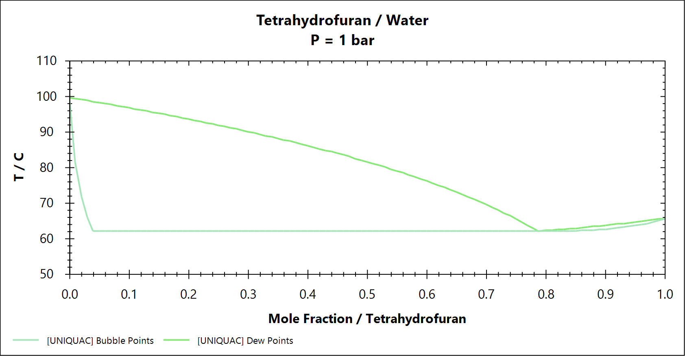
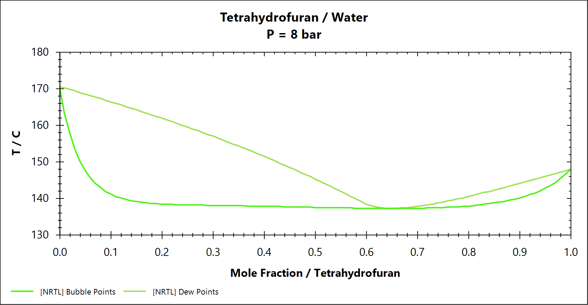

# THF-Water Distillation: Pressure Effects on the Azeotrope Limit

## Overview

THF is a common pharmaceutical solvent that often ends up mixed with water. THF and water form a minimum-boiling azeotrope, so one column can't produce pure THF, but the azeotrope shifts with pressure, which is what pressure-swing distillation uses.

Using DWSIM, Python and SQLite, I:

1. Check which DWSIM model predicts the azeotrope correctly and map it across pressure.
2. Run one column over 9 pressures (1.013 to 8 bar) x 6 reflux ratios x 2 stage counts = 108 runs.
3. Store every run, including failures, in SQLite with a mass balance check.
4. Find how top purity, reflux and reboiler duty change with pressure.

**Setup:** DWSIM Patreon 10.2.16, Wilson property package, feed 2000 kmol/h at 6 mol% THF, 17 stages with feed on stage 14 and a total condenser (feed and column from ChemSep's example flowsheet of Luyben's 2008 design).

## Model check

If the thermodynamic model is wrong, the column still converges and every result is quietly wrong, so I checked the azeotrope first.

**Method.** Txy diagrams from DWSIM's Binary Phase Envelope (VLE, Δx = 0.01) at 1.0 and 8.0 bar, the pressures in the reference paper (AIDIC CET Vol. 61), for the three models with THF-water parameters in DWSIM's database, unchanged:

| Model | a12 (cal/mol) | a21 (cal/mol) | α12 |
|---|---|---|---|
| NRTL | 915.7450 | 1725.0977 | 0.4522 |
| UNIQUAC | 835.2626 | 10.5163 | n/a |
| Wilson | 1140.7179 | 1819.4033 | n/a |

The azeotrope is the minimum of the bubble curve (x = y, Gibbs-Konovalov). `src/find_azeotrope.py` finds where the slope ΔT/Δx changes sign and interpolates, or takes the midpoint if the two lowest points are equal. Difference = |DWSIM - reference| / reference x 100.

### Results

| Model | P (bar) | T_azeotrope (°C) | x_azeotrope (THF) | Reference | Difference | Liquid phases |
|---|---|---|---|---|---|---|
| **Wilson** | 1.0 | 63.69 | 0.8346 | 0.829 | **0.68%** | one |
| **Wilson** | 8.0 | 138.96 | 0.649 ± 0.002 | 0.655 | **0.92%** | one |
| NRTL | 1.0 | 63.67 | 0.8342 | 0.829 | 0.63% | one |
| NRTL | 8.0 | 137.19 | 0.650 ± 0.002 | 0.655 | 0.76% | one |
| UNIQUAC | 1.0 | 62.06 | 0.787* | 0.829 | 5.07% | two |
| UNIQUAC | 8.0 | 133.97 | 0.633* | 0.655 | 3.36% | two |

\* Vapor composition over two liquid phases, so not a normal azeotrope. Data: `data/azeotrope_validation.csv`.

| | Wilson | NRTL | UNIQUAC |
|---|---|---|---|
| **1 bar** |  |  |  |
| **8 bar** |  |  |  |

### What I found

1. **Wilson and NRTL match the reference within 1%.** At 8 bar, T rises from the azeotrope toward pure THF, so pure THF leaves the bottom of an 8 bar column.
2. **Checks:** the water end matches the steam tables (99.61 °C at 1 bar; 170.5 vs 170.41 °C at 8 bar), and the measured 1 atm azeotrope is at 63.43 °C (Matouš et al. 1972, as cited in J. Chem. Eng. Data 2023) vs 64.07 °C from Wilson at 1.013 bar.
3. **UNIQUAC predicts two liquid phases.** Its bubble temperature is flat from x = 0.04 to 0.83 at 1 bar, which by the phase rule means two liquids plus vapor. Real THF-water is miscible there and only splits in a closed loop around 344 to 410 K (Matouš et al. 1972, as cited in a thermal analysis study; Smith et al. 2016), so I ruled UNIQUAC out.
4. **NRTL does the same on a smaller scale:** flat at 64.95 °C for x = 0.10 to 0.42 at 1 bar, matching the split its Gibbs energy of mixing predicts (0.096 to 0.422). My guess is the parameters were fitted to VLE data only.
5. **Wilson can't predict two liquid phases** (Wilson 1964). It would miss a real split, but so does NRTL.

**Model for the column runs: Wilson.** It ties NRTL on composition and avoids NRTL's false liquid split.

## Azeotrope at the sweep pressures

Both models at all 9 sweep pressures (results in `data/azeotrope_by_pressure.csv` and `data/thf.db`):

| P (bar) | 1.013 | 1.5 | 2 | 3 | 4 | 5 | 6 | 7 | 8 |
|---|---|---|---|---|---|---|---|---|---|
| x_azeotrope, Wilson | 0.8336 | 0.8052 | 0.7822 | 0.7467 | 0.7200 | 0.6975 | 0.6775 | 0.6625 | 0.6490 |
| x_azeotrope, NRTL | 0.8330 | 0.8016 | 0.7772 | 0.7412 | 0.7150 | 0.6950 | 0.6775 | 0.6625 | 0.6500 |
| T_azeotrope (°C), Wilson | 64.07 | 76.07 | 85.45 | 99.60 | 110.35 | 119.13 | 126.60 | 133.13 | 138.96 |

- The azeotrope drops fastest at low pressure: 0.058 per bar up to 1.5 bar, 0.014 per bar from 7 to 8 bar.
- The models agree on x at both ends and differ by up to 0.0055 at 2 to 4 bar. NRTL's T_azeotrope is lower by 0.03 °C at 1.013 bar, growing to 1.77 °C at 8 bar.
- NRTL's flat bubble line shrinks to x = 0.20 to 0.31 at 3 bar and is gone from 4 bar.
- For 90% THF recovery at Wilson's azeotrope, D = 0.9 x F x z_THF / x_azeotrope rises from 129.559 to 166.410 kmol/h, and B = 2000 - D (`column_specs` view). 90% is my choice, leaving room for the top to reach the azeotrope.

### Limitations

- The reference is an Aspen Plus NRTL result, so the check is model vs model. I found no measured azeotrope composition or temperature above 1 atm.
- Above 100 °C DWSIM shows T to 0.001 °C, so x_azeotrope from 4 bar up is good to about ±0.002.
- The check uses 1.0 bar and the sweep 1.013 bar; Wilson's x_azeotrope differs by 0.10 mol% between them.

## Repository layout

- `data/`: Txy tables, azeotrope results and `thf.db`
- `src/`, `sql/`: azeotrope finder, SQLite loader, table and view definitions
- `flowsheets/txy_envelopes.dwxmz`: DWSIM file with all Txy envelopes
- `figures/txy_<model>_
bar.png`: Txy diagrams

## Sources

- AIDIC CET Vol. 61: https://www.aidic.it/cet/17/61/235.pdf
- ChemSep example flowsheet `THF_Water_iecr47p2681.fsd` (Luyben, Ind. Eng. Chem. Res. 2008, 47, 2681): http://www.chemsep.com/downloads
- FOSSEE OpenModelica flowsheet of the same design (its abstract says mass fraction 0.06; its code uses mole fraction 0.06, as ChemSep does): https://om.fossee.in/chemical/flowsheeting-project/om-flowsheet-run/77
- Wilson, G. M. J. Am. Chem. Soc. 1964, 86, 127: https://doi.org/10.1021/ja01056a002
- Matouš, J. et al. Collect. Czech. Chem. Commun. 1972, 37, 2653: https://doi.org/10.1135/cccc19722653 (cited through the next two)
- J. Chem. Eng. Data 2023, 68, 349: https://doi.org/10.1021/acs.jced.2c00593
- Thermal analysis study (closed-loop gap): https://core.ac.uk/download/208031307.pdf
- Smith, M. D. et al. J. Phys. Chem. B 2016, 120: https://doi.org/10.1021/acs.jpcb.5b09770
- IAPWS-IF97 steam tables: http://www.iapws.org/relguide/IF97-Rev.html
