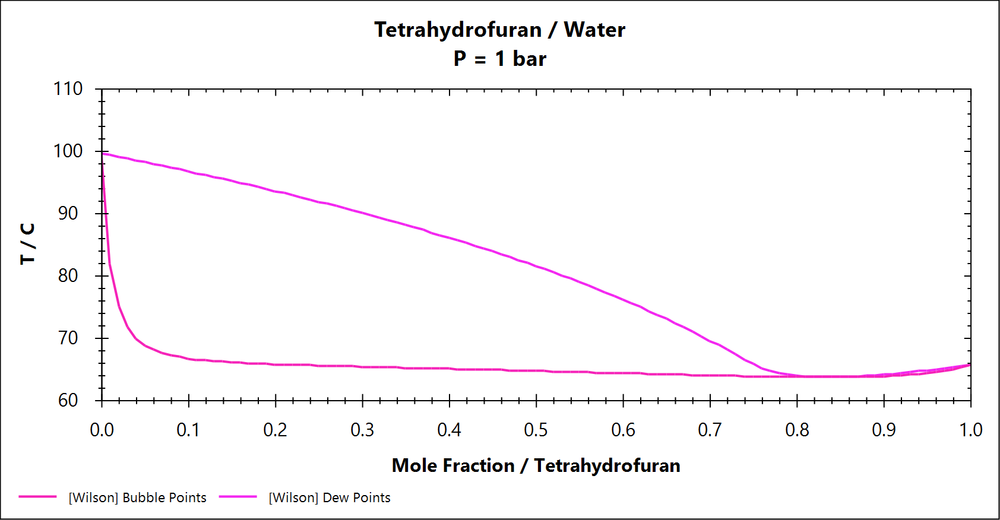
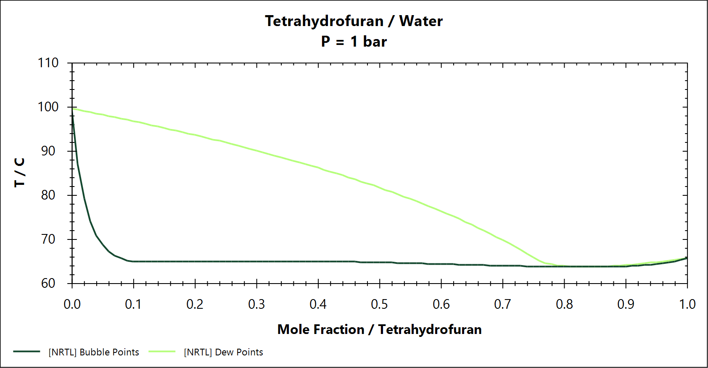
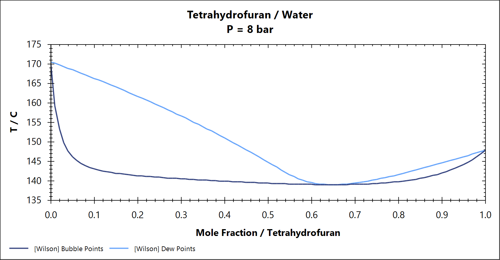
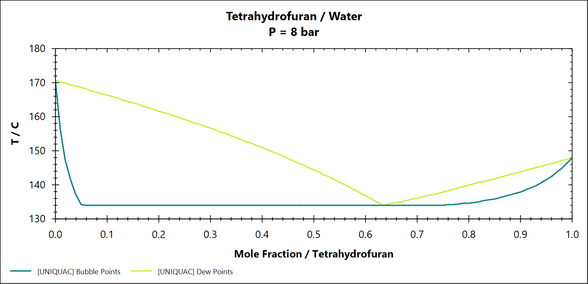

# THF-Water Distillation: Pressure Effects on the Azeotrope Limit

Status: in progress (started 17 Nov 2026). Model check done on 18 Nov 2026.

## Overview

THF is a common pharmaceutical solvent that often ends up mixed with water. THF and water form a minimum-boiling azeotrope, so one column can't produce pure THF, but the azeotrope shifts with pressure, which is what pressure-swing distillation uses.

Using DWSIM, Python and SQLite, I:

1. Check which DWSIM model predicts the azeotrope correctly at 1 and 8 bar.
2. Run one column over 9 pressures (1.013 to 8 bar) x 6 reflux ratios x 2 stage counts = 108 runs.
3. Store every run, including failures, in SQLite with a mass balance check.
4. Find how top purity, reflux and reboiler duty change with pressure.

**Setup:** DWSIM Patreon 10.2.16, Wilson property package, feed 6 wt% THF at 100 kmol/h, 17 stages with feed on stage 13 and a total condenser (feed and column from the FOSSEE flowsheet based on Luyben 2008).

## Model check

If the thermodynamic model is wrong, the column still converges and every result is quietly wrong, so I checked the azeotrope first.

**Method.** I made Txy diagrams with DWSIM's Binary Phase Envelope (VLE, Δx = 0.01) at 1.0 and 8.0 bar, the two pressures in the reference paper (AIDIC CET Vol. 61). I tested the three models that have THF-water parameters in DWSIM's database, using them unchanged:

| Model | a12 (cal/mol) | a21 (cal/mol) | α12 |
|---|---|---|---|
| NRTL | 915.7450 | 1725.0977 | 0.4522 |
| UNIQUAC | 835.2626 | 10.5163 | n/a |
| Wilson | 1140.7179 | 1819.4033 | n/a |

The azeotrope is the minimum of the bubble curve (x = y, Gibbs-Konovalov), so I found where the slope ΔT/Δx between table rows changes sign, using linear interpolation. Difference = |x_azeotrope (DWSIM) - x_azeotrope (reference)| / x_azeotrope (reference) x 100.

### Results

| Model | P (bar) | T_azeotrope (°C) | x_azeotrope (THF) | Reference | Difference | Liquid phases |
|---|---|---|---|---|---|---|
| **Wilson** | 1.0 | 63.69 | 0.8346 | 0.829 | **0.68%** | one |
| **Wilson** | 8.0 | 138.96 | 0.648 ± 0.002 | 0.655 | **0.92%** | one |
| NRTL | 1.0 | 63.67 | 0.8342 | 0.829 | 0.63% | one |
| NRTL | 8.0 | 137.19 | 0.650 ± 0.002 | 0.655 | 0.76% | one |
| UNIQUAC | 1.0 | 62.06 | 0.787* | 0.829 | 5.07% | two |
| UNIQUAC | 8.0 | 133.97 | 0.633* | 0.655 | 3.36% | two |

\* Vapor composition over two liquid phases, so not a normal azeotrope. Reference: AIDIC CET Vol. 61 (Aspen Plus, NRTL). Data: [`data/azeotrope_validation.csv`](data/azeotrope_validation.csv).

| | Wilson | NRTL | UNIQUAC |
|---|---|---|---|
| **1 bar** |  |  |  |
| **8 bar** |  |  |  |

### What I found

1. **Wilson and NRTL match the reference within 1% and agree with each other.** From 1 to 8 bar the azeotrope moves from about 0.835 to 0.649 THF. At 8 bar the temperature rises from the azeotrope toward pure THF, so the 1 bar azeotrope fed to an 8 bar column gives pure THF at the bottom.
2. **Checks:** the pure water end matches the steam tables (99.61 °C at 1 bar; about 170.5 vs 170.41 °C at 8 bar), and the measured 1 atm azeotrope temperature is 63.43 °C (Matouš et al. 1972, as cited in J. Chem. Eng. Data 2023) vs 63.69 °C from Wilson.
3. **UNIQUAC predicts two liquid phases.** Its bubble temperature is flat from about x = 0.04 to 0.83 at 1 bar. By the phase rule (F = 2 - 3 + 2 = 1, which is zero at fixed P), a flat bubble line means two liquids plus vapor. Real THF-water is miscible at its 1 atm boiling point and only splits in a closed loop around 344 to 410 K (Matouš et al. 1972, as cited in a thermal analysis study; Smith et al. 2016), so I ruled UNIQUAC out.
4. **NRTL does the same on a smaller scale:** flat at 64.95 °C for x = 0.10 to 0.42 at 1 bar, matching the split its Gibbs energy of mixing predicts (0.096 to 0.422). It doesn't affect the azeotrope, but column stages in that range would be. My guess is the parameters were fitted to VLE data only.
5. **Wilson can't predict two liquid phases at all** (Wilson 1964), so its curves stay smooth. It would also miss a real split, but NRTL doesn't capture the real one either.

**Model for the column runs: Wilson.** It ties NRTL on azeotrope composition and avoids NRTL's false liquid split.

### Limitations

- The reference values are Aspen Plus NRTL results, so this is model vs model and slightly favours NRTL. I found no measured azeotrope composition at 8 bar.
- At 8 bar, x_azeotrope is only good to about ±0.002, because DWSIM shows T to 0.001 °C there.
- Wilson and NRTL disagree on the 8 bar azeotrope temperature by 1.77 °C, and I found no measured value to settle it.
- The check uses 1.0 bar and the sweep uses 1.013 bar, a difference of about 0.03 mol% in x_azeotrope (from the paper's average slope of 2.49 mol% per bar).

## Repository layout

- `data/azeotrope_validation.csv`: model check results
- `flowsheets/txy_envelopes.dwxmz`: DWSIM file with the Txy envelopes
- `figures/txy_<model>_
bar.png`: Txy diagrams
- `src/`, `sql/`, `docs/`: Python scripts, database queries and data dictionary (in progress)

## Sources

- AIDIC CET Vol. 61, THF-water extractive vs pressure-swing distillation: https://www.aidic.it/cet/17/61/235.pdf
- FOSSEE THF/water pressure-swing flowsheet (based on Luyben 2008): https://om.fossee.in/chemical/flowsheeting-project/download/abstract-file/77
- Wilson, G. M. J. Am. Chem. Soc. 1964, 86, 127-130: https://doi.org/10.1021/ja01056a002
- Matouš, J. et al. Collect. Czech. Chem. Commun. 1972, 37, 2653-2663: https://doi.org/10.1135/cccc19722653 (cited through the next two sources)
- J. Chem. Eng. Data 2023, 68, 349 (1 atm azeotrope at 63.43 °C, citing Matouš): https://doi.org/10.1021/acs.jced.2c00593
- Thermal analysis study citing Matouš for the closed-loop gap: https://core.ac.uk/download/208031307.pdf
- Smith, M. D. et al. J. Phys. Chem. B 2016, 120: https://doi.org/10.1021/acs.jpcb.5b09770
- IAPWS-IF97 steam tables: http://www.iapws.org/relguide/IF97-Rev.html
