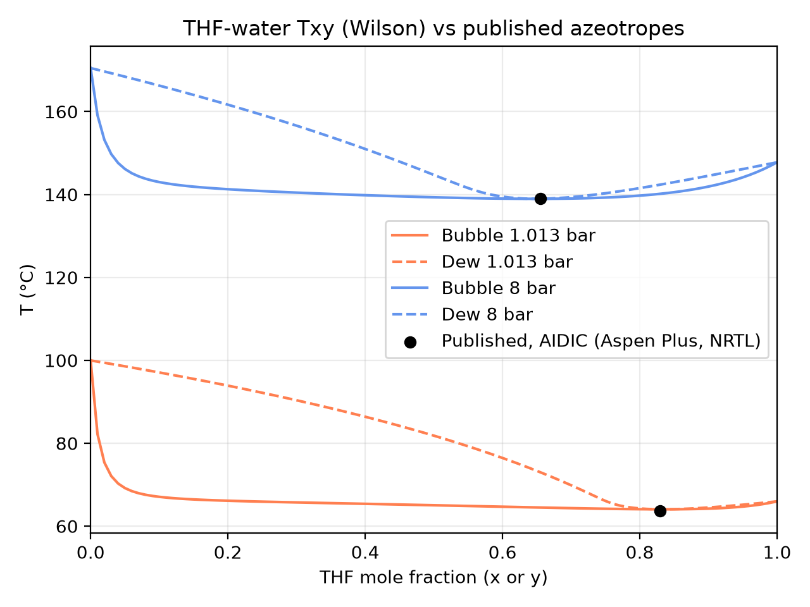
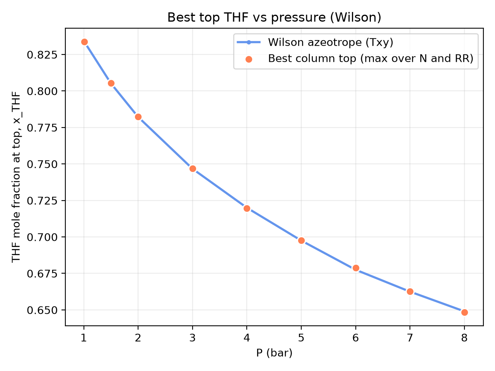
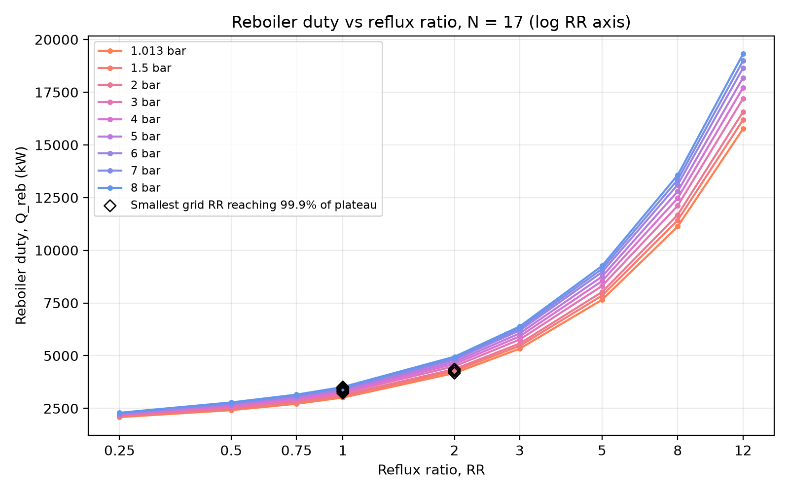
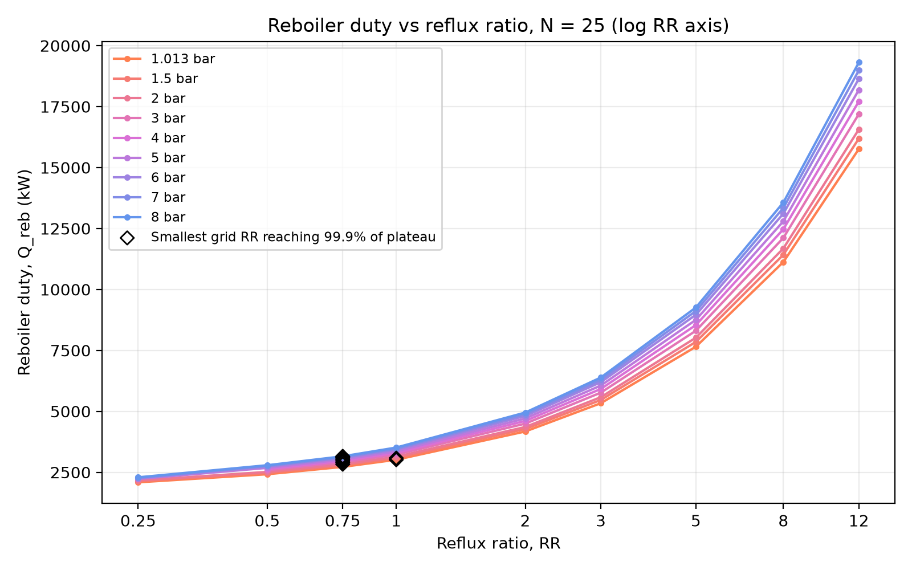

# THF-Water Distillation: Pressure, the Azeotrope and Reboiler Duty

## Overview

THF is a common pharmaceutical solvent that often ends up mixed with water. THF and water form a minimum-boiling azeotrope, so one column can't produce pure THF, but the azeotrope shifts with pressure, which is what pressure-swing distillation uses. Before designing that process, I mapped what a single column can do at each pressure.

Using DWSIM, Python and SQLite, I:

1. Checked which DWSIM model predicts the azeotrope correctly and mapped it from 1.013 to 8 bar.
2. Ran one column over 9 pressures x 9 reflux ratios (0.25 to 12) x 2 stage counts (17, 25) = 162 runs from Python, storing every run, failures included, in SQLite with a THF balance check.
3. Used SQL to find the best top purity at each pressure, the smallest reflux ratio that reaches it, and its reboiler duty.

**Key results**

- The azeotrope moves from 83.4 to 64.9 mol% THF between 1.013 and 8 bar (Wilson, within 1% of a published Aspen Plus result), and the column top stops at it at every pressure.
- The lowest reboiler duty that reaches the top-purity plateau is 2831 kW at 2 bar, 25 stages, RR 0.75: 6.1% below 1.013 bar and 10.3% below 8 bar.
- 25 stages instead of 17 cut that duty by 10 to 35% by reaching the plateau at a lower reflux ratio.
- 160 of 162 runs converged; the sweep reproduces my 8 manual DWSIM runs to every displayed digit.

**Setup:** DWSIM Patreon 10.2.16, Wilson property package, feed 2000 kmol/h at 6 mol% THF, 17 stages with feed on stage 14 and a total condenser (from ChemSep's example flowsheet of Luyben's 2008 design). The 25-stage column feeds on stage 21, scaled from 14/17 (my assumption).

## Model check

If the thermodynamic model is wrong, the column still converges and every result is quietly wrong, so I checked the azeotrope first.

**Method.** Txy diagrams from DWSIM's Binary Phase Envelope (VLE, Δx = 0.01) at 1.0 and 8.0 bar (the pressures in AIDIC CET Vol. 61) for the three models with stored THF-water parameters, unchanged (Wilson: a12 = 1140.72, a21 = 1819.40 cal/mol). The azeotrope is the minimum of the bubble curve; `src/find_azeotrope.py` finds where ΔT/Δx changes sign and interpolates.

| Model | x_azeotrope, 1.0 bar (ref. 0.829) | x_azeotrope, 8.0 bar (ref. 0.655) | Liquid phases |
|---|---|---|---|
| **Wilson** | 0.8346 (**0.68%**) | 0.649 ± 0.002 (**0.92%**) | one |
| NRTL | 0.8342 (0.63%) | 0.650 ± 0.002 (0.76%) | one |
| UNIQUAC | 0.787* (5.07%) | 0.633* (3.36%) | two |

\* Vapor over two liquid phases, so not a normal azeotrope. Data: `data/azeotrope_validation.csv`; all Txy diagrams in `figures/`.



*Figure 1. Wilson Txy at 1.013 and 8 bar with the published azeotropes, placed at Wilson's T_azeotrope since the paper gives composition only. The low one is at 1.0 bar, where Wilson's x_azeotrope is 0.10 mol% above its 1.013 bar value.*

### What I found

1. **Wilson and NRTL match the reference within 1%.** At 8 bar, T rises from the azeotrope toward pure THF, so pure THF leaves the bottom of an 8 bar column.
2. **Checks:** the water end matches the steam tables (170.5 vs 170.41 °C at 8 bar), and the measured 1 atm azeotrope is at 63.43 °C (Matouš et al. 1972, cited in J. Chem. Eng. Data 2023) vs 64.07 °C from Wilson.
3. **UNIQUAC predicts two liquid phases** (flat bubble line, x = 0.04 to 0.83 at 1 bar), but real THF-water only splits in a closed loop around 344 to 410 K (Matouš et al. 1972; Smith et al. 2016), so I ruled it out. NRTL shows a smaller false split (x = 0.10 to 0.42 at 1 bar). Wilson can't predict two liquids at all (Wilson 1964).
4. **Peng-Robinson has no THF-water kij in DWSIM**, and its bubble and dew curves never meet at 1.013 bar (`data/pr_check_txy_1.013bar.csv`), so I ruled it out.

**Model for the column runs: Wilson.** It ties NRTL on composition without NRTL's false liquid split.

| P (bar) | 1.013 | 1.5 | 2 | 3 | 4 | 5 | 6 | 7 | 8 |
|---|---|---|---|---|---|---|---|---|---|
| x_azeotrope | 0.8336 | 0.8052 | 0.7822 | 0.7467 | 0.7200 | 0.6975 | 0.6775 | 0.6625 | 0.6490 |
| T_azeotrope (°C) | 64.07 | 76.07 | 85.45 | 99.60 | 110.35 | 119.13 | 126.60 | 133.13 | 138.96 |

For 90% THF recovery at the azeotrope, D = 0.9 x F x z_THF / x_azeotrope rises from 129.6 to 166.4 kmol/h, with B = 2000 - D (`column_specs` view).

## Column sweep

**Method.** `src/run_case.py` solves the column through DWSIM's Python API for one pressure, reflux ratio (RR), stage count (N) and bottoms flow. `src/sweep.py` runs the grid and writes every run to the `runs` table in `data/thf.db`. Queries: `sql/queries.sql`.

**Quality checks.**

- **Validation:** matches my 8 manual DWSIM runs (N 17, RR 2 and 5, at 1.013, 3, 5 and 8 bar; `data/manual_runs.csv`).
- **Failures:** 2 of 162 runs hit the solver's iteration limit (N 25, RR 0.25, 3 and 4 bar). I didn't rerun them (cause unconfirmed); no result uses RR 0.25.
- **THF balance:** relative error below 1e-9 in 154 of 160 converged runs; the other six are at RR 0.25 (worst 1.8e-5).
- **Recovery:** 89.7 to 90.2% from RR 0.75 up, limited by x_azeotrope precision. Below RR 0.75 the top falls short (80 to 89.8% recovery).

**Smallest grid RR** is the lowest RR on my grid where the top reaches 99.9% of that pressure's plateau (top composition at 25 stages, RR 12). It is a definition I chose and an upper bound on the true minimum reflux.

| P (bar) | 1.013 | 1.5 | 2 | 3 | 4 | 5 | 6 | 7 | 8 |
|---|---|---|---|---|---|---|---|---|---|
| Best top x_THF | 0.8338 | 0.8053 | 0.7823 | 0.7469 | 0.7197 | 0.6975 | 0.6788 | 0.6626 | 0.6484 |
| Smallest grid RR, N 17 | 2 | 2 | 2 | 1 | 1 | 1 | 1 | 1 | 1 |
| Q_reb (kW) | 4174 | 4274 | 4359 | 3226 | 3296 | 3362 | 3429 | 3472 | 3514 |
| Smallest grid RR, N 25 | 1 | 1 | 0.75 | 0.75 | 0.75 | 0.75 | 0.75 | 0.75 | 0.75 |
| Q_reb (kW) | 3015 | 3082 | **2831** | 2908 | 2968 | 3025 | 3083 | 3120 | 3155 |



*Figure 2. Best top x_THF (any N, RR) vs Wilson's x_azeotrope; ratio 0.999 to 1.002.*

| N 17 | N 25 |
|---|---|
|  |  |

*Figure 3. Reboiler duty vs RR (log axis; linear versions in `figures/`). Markers show the smallest grid RR and overlap because at RR 0.75 to 2 the nine pressures are only 430 to 780 kW apart. For N 25, the 3 and 4 bar lines start at RR 0.5.*

### What I found

1. **The azeotrope caps the top purity** (Figure 2). The cap falls from 0.834 to 0.648 with pressure, which a second column at another pressure exploits.
2. **Reflux past the plateau wastes energy.** Duty rises almost linearly with RR (about 1160 kW per unit RR at 1.013 bar, since vapor flow = (RR + 1) x D); at 2 bar, RR 12 costs 5.9 times the duty of RR 0.75 for the last 0.1%.
3. **Pressure has two competing effects.** Higher pressure reaches its plateau at a lower RR, but needs a larger D for the same recovery. They balance at 2 bar. Why the required RR falls with pressure is unconfirmed.
4. **More stages save energy only through lower reflux:** at the same RR, N 17 and N 25 use the same duty (within 0.4 kW from RR 2 up).

### Limitations

- The reference is an Aspen Plus NRTL result, so the model check is model vs model; I found no measured azeotrope above 1 atm.
- Above 100 °C DWSIM shows T to 0.001 °C, so x_azeotrope from 4 bar up is good to about ±0.002.
- The RR grid is coarse (nothing between 0.75 and 1); a finer grid could move the 2 bar result.
- I compared reboiler duty only: no column sizing, cost or other feed compositions.

## Reproducing

From the repo root, `python src/plot_fig1_txy.py` (and fig 2, 3) rebuilds a figure from `data/`. `src/sweep.py` needs DWSIM and rebuilds the `runs` table.

## Repository structure

<details>
<summary>Show folder layout</summary>

```
thf-solvent-recovery/
├── data/          # Txy tables, azeotrope results, manual_runs.csv, thf.db
├── sql/           # table definitions and queries.sql
├── src/           # find_azeotrope.py, run_case.py, sweep.py, plot_fig*.py and helpers
├── flowsheets/    # txy_envelopes.dwxmz, base_1.013bar.dwxmz
├── figures/       # fig1 to fig3, Txy diagrams txy_<model>_<P>bar.png
├── docs/          # empty for now
└── README.md
```

</details>

## Sources

- AIDIC CET Vol. 61: https://www.aidic.it/cet/17/61/235.pdf
- ChemSep example flowsheet `THF_Water_iecr47p2681.fsd` (Luyben, Ind. Eng. Chem. Res. 2008, 47, 2681): http://www.chemsep.com/downloads
- FOSSEE OpenModelica flowsheet of the same design (abstract says mass fraction 0.06, code uses mole fraction): https://om.fossee.in/chemical/flowsheeting-project/om-flowsheet-run/77
- FOSSEE DWSIM flowsheet (Peng-Robinson): https://dwsim.fossee.in/flowsheeting-project/dwsim-flowsheet-run/102
- Wilson, G. M. J. Am. Chem. Soc. 1964, 86, 127: https://doi.org/10.1021/ja01056a002
- Matouš, J. et al. Collect. Czech. Chem. Commun. 1972, 37, 2653: https://doi.org/10.1135/cccc19722653 (cited through the next two)
- J. Chem. Eng. Data 2023, 68, 349: https://doi.org/10.1021/acs.jced.2c00593
- Thermal analysis study (closed-loop gap): https://core.ac.uk/download/208031307.pdf
- Smith, M. D. et al. J. Phys. Chem. B 2016, 120: https://doi.org/10.1021/acs.jpcb.5b09770
- IAPWS-IF97 steam tables: http://www.iapws.org/relguide/IF97-Rev.html
